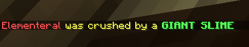

# CustomDeathMessages

CustomDeathMessages replaces vanilla death messages with configurable templates for PvP, mobs, projectiles, environmental causes, and unknown fallback deaths. It supports Spigot and Paper servers from 1.8 through 26.x, includes in-game editing commands, and works with Discord bridges such as EssentialsDiscord and DiscordSRV.

## Features

- Custom message lists for PvP, melee, projectile, environmental, mob, and fallback death causes.
- A message list for any mob or damage cause, just by adding a list named after it (see below).
- Toggleable global death messages.
- Toggleable PvP messages sent directly to the killer and victim.
- Optional hover text showing the original vanilla death message.
- Optional hoverable item tooltip for the killer's weapon (`%kill-weapon%`), for players and mobs.
- Optional lightning strike effect at the death location.
- Optional player head drops with configurable drop chance and display name.
- Per-player global death message cooldown to reduce spam.
- Custom named entity messages that can override the normal mob-group message.
- Optional PlaceholderAPI support, including per-player scoped placeholders.
- Hex color support using `&#RRGGBB` (approximated with the closest standard color before 1.16).
- Respects the `showDeathMessages` gamerule, vanish plugins and other plugins that change or hide death messages.
- Update notifications for staff with `cdm.updates`.
- Developer debug commands gated behind `developer-mode`.

## Commands

Primary command aliases: `/cdm`, `/customdeathmessages`, `/customdeathmessage`, `/deathmessage`, `/deathmessages`

| Command | Permission | Notes |
| --- | --- | --- |
| `/cdm reload` | `cdm.reload` | Reloads the config and clears cooldowns. If `config.yml` has an error, the previous configuration stays active and the error (with line and column) is shown. |
| `/cdm add <path> <death message>` | `cdm.modify` | Adds a message to a death message list. The list is created if it does not exist yet (its name must end with `-messages`). |
| `/cdm list <path>` | `cdm.modify` | Lists the messages of a list with indices, showing the raw text with `&` codes. |
| `/cdm remove <path> <index>` | `cdm.modify` | Removes a message by index. Removing the last message makes that death use the vanilla message. |
| `/cdm set flag <path> <true\|false>` | `cdm.modify` | Sets a boolean config value. |
| `/cdm set message <path> <message>` | `cdm.modify` | Sets a string config value. |
| `/cdm set number <path> <value>` | `cdm.modify` | Sets a numeric config value (validated, e.g. `drop-head-percentage` must be between 0 and 1). |
| `/cdm debug prime [player]` | `cdm.debug` | Sets a player to 1 health for testing. Requires `developer-mode: true`. |
| `/cdm debug shoot [player]` | `cdm.debug` | Kills a player with an instant-kill melee hit from you, for testing. Requires `developer-mode: true`. |
| `/cdm debug hover [player]` | `cdm.debug` | Sends a test death message using the item in your hand, rendered exactly like a real one. Requires `developer-mode: true`. |

Command edits re-read `config.yml` before saving, so changes made to the file by hand are kept, and nothing is saved while the file contains an error. Config paths and death message lists are tab-completed.

## Config Overview

Boolean paths available to `/cdm set flag`:

- `enable-update-messages`
- `enable-pvp-messages`
- `enable-lightning`
- `enable-global-messages`
- `enable-original-on-hover`
- `enable-item-on-hover`
- `enable-custom-name-entity-messages`
- `developer-mode`

String paths available to `/cdm set message`:

- `killer-message`
- `victim-message`
- `head-name`

Number paths available to `/cdm set number`:

- `drop-head-percentage` (0 to 1; 0.25 = 25%)
- `message-cooldown` (seconds; only limits the global death message)

### Death message lists

Death messages live in the `*-messages` lists in `config.yml`, for example `global-pvp-death-messages`, `melee-death-messages`, `custom-name-entity-messages`, `fall-damage-messages`, `creeper-messages`, `arrow-messages` and `unknown-messages`. One message is picked at random from the list.

- An empty list (`fall-damage-messages: []`) keeps the vanilla death message for that death.
- A blank message (`""`) hides the death message entirely.
- Any entity type or damage cause can have its own list, named after it in lower case with dashes plus `-messages`, for example `trader-llama-messages`, `bogged-messages` or `dryout-messages`. Such a list is used automatically and takes priority over the built-in grouping, so new mobs only need a config entry.
- Deaths without a matching list use `unknown-messages`; the console names the list you could add (once per type).

`melee-death-messages` is used when a player kills another player with a direct hit while holding nothing. Thorns, dragon breath and the warden's sonic boom use their dedicated lists.

## Placeholders

Available in every message:

- `%victim%`, `%victim-nick%`
- `%victim-x%`, `%victim-y%`, `%victim-z%`, `%victim-world%`

Available when something killed the player (empty otherwise):

- `%killer%`, `%killer-nick%`, `%entity-name%`
- `%killer-x%`, `%killer-y%`, `%killer-z%`, `%killer-world%`
- `%kill-weapon%`: the item the killer was holding (players and mobs)

The killer is whatever dealt the lethal damage: the shooter of a projectile, the player who lit TNT, the owner of evoker fangs. Players who merely hit the victim earlier are not credited, and dying to your own arrow, firework or ender pearl has no killer.

When item hover is enabled, `%kill-weapon%` becomes a hoverable item with the item's tooltip. When it is disabled, it is replaced with the weapon name.

Text controlled by players (names, nicknames, item names) is inserted as-is: color codes and placeholders inside it are not interpreted.

### PlaceholderAPI

If PlaceholderAPI is installed, its placeholders are also parsed in death-message templates, direct PvP messages, and the head name.

Plain PlaceholderAPI placeholders use the message's default player context, which is the victim for global death messages, the killer for killer-only messages, and the victim for victim-only messages.

For dual-context PlaceholderAPI usage, CustomDeathMessages also supports these scoped forms:

- `%papi_victim_<placeholder>%`
- `%papi_killer_<placeholder>%`

Examples:

- `%papi_victim_player_name%`
- `%papi_victim_luckperms_prefix%`
- `%papi_killer_player_name%`
- `%papi_killer_vault_prefix%`

These scoped forms are a CustomDeathMessages feature, not native PlaceholderAPI syntax. The victim-scoped form always uses the dead player as context. The killer-scoped form only resolves when the killer is a player.

## Discord

Custom death messages are set on the death event itself, so Discord bridges such as EssentialsDiscord and DiscordSRV forward them with their own formatting, vanish checks and settings. No extra configuration is needed.

## Notes

- `cdm.updates` allows a player to receive update notifications on join when `enable-update-messages` is enabled. The update check runs in the background at startup and every few hours.
- `config-version` is managed by the plugin and cannot be edited through commands.
- If `config.yml` cannot be parsed at startup, the plugin stays disabled and logs the error with its line and column.
- Head drops are added to the death drops, so grave and death-chest plugins can pick them up.

## Development

- `mvn package` builds `target/CustomDeathMessages.jar`.
- The plugin compiles against the Paper 1.16.5 API; anything newer is accessed defensively so the same jar runs on 1.8 through 26.x.
